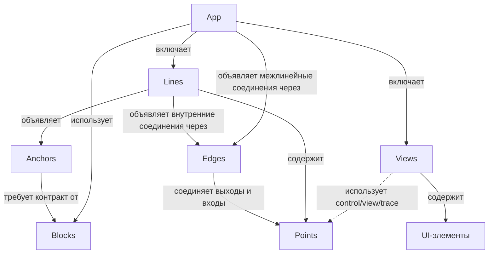
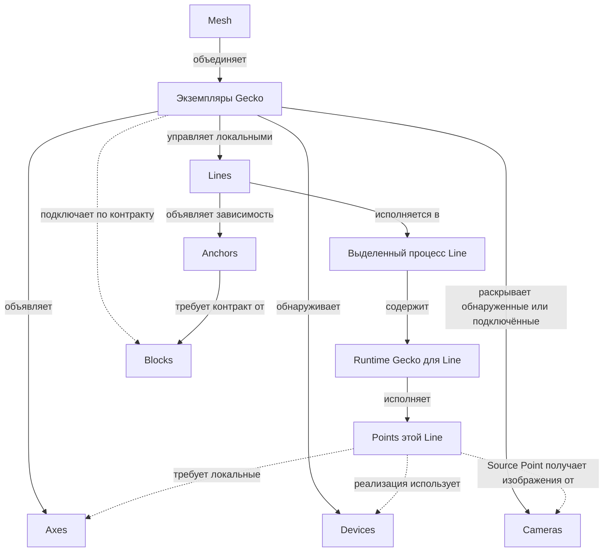

# Gecko — карта понятий

Версия 0.9 · 13 октября 2026 года · [English](0-concepts.md)

Этот документ задаёт общий язык для проектирования первых версий Gecko. App задаёт единый опыт взаимодействия с прикладной задачей: от доступных возможностей до проверяемого результата. Остальные понятия описывают обработку, её исполнение, поддержанные соединения и зависимости от общих сервисов. Форматы API, конфигурации и конкретные механизмы реализации будут выбраны отдельно.

Основа — обсуждения [«Сравнение Gecko и Kubernetes»](https://chatgpt.com/g/g-p-6a1ac79a34548191ac02427895e5a00f/c/6ac20d5b-1eb4-83eb-8543-d13148c2f8e1), [«Архитектура пайплайна»](https://chatgpt.com/c/6ac273bd-a1c0-83eb-8759-4d3000c859d8) и последующее уточнение словаря в этом чате. Line задаёт конкретную единицу исполнения; Point обозначает логическую группу внутри Line; Block определяется предметным контрактом, а Anchor явно описывает зависимость Line от его поставщика. Device обозначает оборудование, на котором исполняются выбранные реализации.

**Статус:** согласованный рабочий каркас для проектирования. Он не описывает уже реализованные возможности. Обнаружение возможностей, автоматическая проверка соединений, предложение композиции App и подготовка известных сервисов входят в целевой UX. Конкретный объём первой версии выбирается отдельно; автоматическая миграция работающих участников, балансировка и бесшовный failover не следуют из этого workflow.

Mesh обменивается фактами и возможностями децентрализованно и раскрывает уже доступные сведения во время обнаружения. Pub/sub — принятое архитектурное основание; роль брокера и минимальные требования к нему определяются на уровне Mesh. Init и Postinit описывают обнаружение, Build — процесс подготовки выбранной ревизии, Activation — отдельный ввод в эксплуатацию; App обозначает композицию, а не этап. Варианты размещения, распределение ответственности и открытые вопросы описаны в [Mesh / App](1-mesh-app.ru.md). Planner — внешняя система построения App; в первой версии создавший App Gecko выполняет обязанности App Authority и Coordinator для предусматривающих координацию операций. Механизмы обновления и доставки сообщений принадлежат брокеру, предметные контракты — соответствующим слоям Gecko.

Эти вопросы уточняют реализацию, сохраняя основу: Gecko обнаруживает Devices, раскрывает Cameras и объявляет Axes; App задаёт единый опыт проверки задачи на основе возможностей Mesh независимо от способа взаимодействия; Lines задают границы исполнения; Points организуют обработку и объявляют control/view/trace; Views представляют App пользователю; Edges задают поддержанные соединения; Blocks определяются предметными контрактами; Anchors описывают зависимости Lines от их поставщиков. Подготовка поставщика — отдельная опциональная возможность, которая не меняет контракт Block.

**Тематические документы:**

1. [Mesh / App](1-mesh-app.ru.md)
2. [Gecko / Axis](2-gecko-axis.ru.md)
3. [Line / Point / Edge / View](3-line-point-edge-view.ru.md)
4. [Block / Anchor](4-block-anchor.ru.md)

## 1. Основная идея

Пользователь запускает экземпляры Gecko на доступных машинах и платформах. Каждый Gecko обнаруживает доступные Devices, раскрывает обнаруженные или явно подключённые Cameras, объявляет Axes, известные реализации обработки и подключённые сервисы. Доступные друг другу экземпляры Gecko образуют Mesh; поддержанные проверки соединений дают сведения о пропускной способности и задержке.

Под задачу внешний Planner строит варианты состава и размещения обработки с учётом сведений Mesh и API Gecko. App объединяет описание композиции и доступное пользователю взаимодействие с ней: обнаружить возможности, собрать или выбрать вариант, проверить его, запустить, наблюдать результат и изменить обработку. Выбранный вариант имеет явную конфигурацию Lines, поддержанных соединений, зависимостей от Blocks и Views и может сохраняться. Line состоит из Points и исполняется в одном выделенном процессе с runtime Gecko. Block определяется понятным Gecko предметным контрактом; сервис, удовлетворяющий этому контракту, подключается как Block. Anchor задаёт зависимость конкретной Line от такого поставщика. View представляет выбранные данные, управление и диагностику App пользователю.

```text
App: inspection

Camera front → Source Point в Line front_camera
Camera back  → Source Point в Line back_camera

Line front_camera ── Anchor detector ──→ Block inference
Line back_camera  ── Anchor detector ──→ Block inference

Внутри front_camera (соединения реализованы через поддержанные Edges):
Source Point → Inference Point → Tracking Point → Output Point
```

App описывает состав и связи Lines, их Points и используемых Blocks для конкретной прикладной задачи. Line задаёт конкретную границу исполнения, Points — её внутреннюю функциональную структуру. Контракт Block и конкретный поставщик этого контракта различаются. Контейнер, внешний сервис или gecko-native реализация могут стать поставщиками одного контракта; Block не задаёт способ их развёртывания и владение процессом.

### 1.1. App как единый опыт взаимодействия

**Снижение порога проверки идеи — ответственность Gecko.** App задаёт общий опыт работы с задачей независимо от способа взаимодействия. Пользователем может быть инженер, агент или программный потребитель. Доступные возможности, условия их использования, действия и результаты должны иметь одинаковый смысл для всех; конкретная форма представления выбирается отдельно.

Gecko сразу раскрывает известные возможности Devices, Cameras, Axes, Points, Edges и Blocks, условия Anchors и доступные представления данных. На их основе внешний Planner строит варианты App; Gecko сообщает, что готово сейчас, что можно подготовить и чего не хватает. Наличие устройства само по себе не обещает работающую обработку: учитываются совместимость, ресурсы и готовность зависимостей.

Пользователь задаёт задачу, входные данные и ограничения, получает доступные варианты и проверяет результат. Обнаружение возможностей и предметные проверки выполняет Gecko; варианты исполнения строит внешний Planner. Технические сведения доступны для диагностики и ручного управления; изучение всей структуры исполнения не должно быть обязательным условием первого эксперимента.

Целевой цикл: **задача и входные данные → вариант App → первый наблюдаемый результат → изменение → повторная проверка → развёртывание в рабочем окружении**. Основной критерий этого опыта — время и число необходимых действий от намерения до первого проверяемого результата на реальных данных. Доступные модели и данные ограничивают то, какую гипотезу можно проверить; App делает эти ограничения явными.

## 2. Двенадцать основных терминов

| Термин | Определение | Практическая граница |
|---|---|---|
| **[Gecko](2-gecko-axis.ru.md)** | Запущенный экземпляр runtime на конкретной машине или платформе. | Обнаруживает Devices, раскрывает Cameras, объявляет возможности, управляет локальными Lines и подключает Blocks по контрактам; может поддерживать подготовку известных сервисов. |
| **[Mesh](1-mesh-app.ru.md)** | Децентрализованная система обмена фактами и возможностями между экземплярами Gecko. | Раскрывает частичные результаты обнаружения и потенциальные места исполнения; основа для проверки связей и вариантов App, без обязательного главного Gecko. Появление участника не меняет работающую композицию само по себе. |
| **[App](1-mesh-app.ru.md)** | Композиция для прикладной задачи и единый опыт взаимодействия с её возможностями, действиями и результатами. | Planner строит варианты по сведениям Mesh и API Gecko; Gecko предоставляет проверки и операции запуска, наблюдения и изменения независимо от способа взаимодействия; выбранный вариант фиксирует Lines, Edges, Anchors, Blocks, Views, реализации и размещение. |
| **[Line](3-line-point-edge-view.ru.md)** | Именованная цепочка обработки из Points с общей конфигурацией, жизненным циклом и диагностикой. | Конкретная единица исполнения: один выделенный процесс с runtime Gecko на одном Gecko. |
| **[Point](3-line-point-edge-view.ru.md)** | Адресуемая логическая группа обработки внутри Line. | Объявляет интерфейсы обработки и возможности control/view/trace; самостоятельный процесс или перезапуск из этого не следует. |
| **[View](3-line-point-edge-view.ru.md)** | Пользовательское представление App, объединяющее отображение данных, состояния и доступные пользователю действия. | Состоит из UI-элементов с явными привязками к объявленным возможностям App; визуальное представление не является условием доступа к возможностям App и не задаёт отдельного процесса. |
| **[Block](4-block-anchor.ru.md)** | Предметная сервисная возможность, определяемая контрактом Gecko. | Конкретный сервис подключается как Block после проверки контракта; требования к железу и способ запуска принадлежат реализации поставщика. Может обслуживать несколько Lines. |
| **[Anchor](4-block-anchor.ru.md)** | Зависимость Line от общего сервиса, задающая требуемый контракт и условия, при которых Line может работать. | Ссылается на конкретный Block; фиксирует нужные возможности, условия готовности и поведение при недоступности. |
| **[Edge](3-line-point-edge-view.ru.md)** | Поддержанный способ соединения выхода одного Point со входом другого Point с заданными правилами и ограничениями. | При сборке применяется к конкретным интерфейсам Points одной или разных Lines. Выставленный интерфейс Line ссылается на интерфейс её Point. |
| **[Axis](2-gecko-axis.ru.md)** | Возможность среды исполнения, которую объявляет Gecko. Множественное число — **Axes**. | Сопоставляется с локальными требованиями выбранных реализаций; доступность Block проверяется через Anchors. |
| **[Device](#4-devices)** | Адресуемая аппаратная единица исполнения, доступная конкретному Gecko. | CPU, GPU или другой ускоритель с характеристиками, внутренней структурой, ресурсами и состоянием; не является Block или Axis. |
| **[Camera](#5-cameras)** | Адресуемый источник изображений от конкретной камеры, обнаруженный или явно подключённый к Gecko. | Раскрывает известные потоки или режимы получения изображений и условия доступа. Source Point получает её данные для Line; Camera сохраняет идентичность независимо от Line и не является вычислительным Device, Point или Axis. |

«Проект Gecko» означает систему целиком, а «экземпляр Gecko» — конкретный runtime. Машина предоставляет окружение для Gecko. Число экземпляров на одной машине этот документ не ограничивает.

Геометрические названия отражают структуру: Point — функциональная точка внутри Line; Line — цепочка обработки; Block — сервисная возможность по контракту; Edge — поддержанный способ соединения; Anchor — опора Line на сервис; View — проекция App для пользователя. Для оборудования используется привычное название Device без геометрического переименования. В словаре используется Point. Dot не вводится как отдельная сущность.

## 3. Структура и границы исполнения

### 3.1. Состав App

Эта схема описывает состав приложения и связи понятий. Line содержит Points. Каждое соединение обработки через Edge связывает выход Point со входом Point, принадлежащих одной или разным Lines. Line объявляет внутренние соединения, App — соединения через границы Lines. Anchors описывают зависимости от Blocks. Camera и Device относятся к среде исполнения, показанной в разделе 3.2.



UI-элементы принадлежат Views App. Slider, Button и VideoView не считаются Points обработки внутри Line. Они связываются с объявленными возможностями Lines, их Points и Blocks. Требование отдельного процесса для Line не распространяется на View или каждый UI-элемент.

### 3.2. Среда и границы исполнения

Эта схема описывает размещение и исполнение. App может охватывать несколько Gecko; конкретная Line целиком исполняется на одном из них. Gecko раскрывает обнаруженные или подключённые Cameras; получение их изображений выполняет Source Point внутри Line. Camera может быть локальной или сетевой. Подключение Block по контракту не означает размещения его процесса на этом Gecko.



Line имеет явную границу: один Gecko и один выделенный процесс с runtime Gecko при исполнении. Размещается Line целиком. Points внутри неё нельзя независимо переносить на другие машины без изменения структуры исполнения.

**Один источник → одна Line — политика по умолчанию.** Источником может быть камера, файл или другой поддержанный источник. Несколько входов в одной Line возможны при явной поддержке такого сценария; это не обязательство первой версии.

Block имеет собственную границу сервиса, которую задаёт его реализация. Общий Block не объединяет Lines и не меняет их границы перезапуска. Gecko может управлять запуском сервиса, если это поддержано, но не устанавливает для каждого Block правило «один выделенный процесс».

### 3.3. Изменения словаря

#### От версии 0.3 к 0.4

| Раньше | Теперь |
|---|---|
| Состав App и среда исполнения смешаны в одной схеме | Композиция App показана отдельно от размещения и исполнения |

## 4. Devices

Device — CPU, дискретная или встроенная GPU, NPU или другой аппаратный ускоритель, который Gecko отдельно идентифицирует и выбирает для исполнения. ARM/x86 — характеристики архитектуры CPU, а Jetson или embedded-плата — платформы с доступными на них Devices. Для первой версии CPU можно представлять одним Device на машине, описывая ядра и логические CPU внутри; детализация сокетов и NUMA выбирается при необходимости.

```text
Gecko jetson-01
├── платформа: Jetson
├── Device cpu-0: архитектура arm64, ядра и логические CPU
├── Device gpu-0: характеристики, память, состояние
├── Camera entrance: подключение, потоки и режимы, состояние доступа
└── Axes: проверенные доступные возможности исполнения
```

Каждое ядро CPU не становится отдельным Device. Ядра, потоки, память и другие внутренние ресурсы учитываются при размещении и исполнении. Affinity, quota и исключительное резервирование — разные условия; привязка к логическим CPU сама по себе не означает их эксклюзивного выделения. Конкретные механизмы распределения ресурсов выбираются отдельно.

Одна Line может использовать несколько Devices, например CPU для подготовки данных и GPU для inference, сохраняя один процесс на одном Gecko. Физическое наличие Device не гарантирует доступную Axis: нужны совместимое программное окружение и фактический доступ. При нескольких экземплярах Gecko на одной машине оборудование может быть общим; объявления нод не означают независимые запасы ресурсов.

### 4.1. Изменения словаря

#### От версии 0.4 к 0.5

| Раньше | Теперь |
|---|---|
| Оборудование упоминается без адресуемой сущности | Device описывает CPU, GPU и ускорители; ядра и потоки остаются внутренними ресурсами |

### 4.2. Открытые вопросы

- Форматы описания Devices, топологии, требований и привязок; учёт общих ресурсов и правила резервирования.

## 5. Cameras

Camera обозначает конкретный источник изображений, например локально подключённую или сетевую камеру. Gecko раскрывает её стабильное имя, известные потоки и режимы (формат, разрешение, частоту кадров), состояние доступа и поддержанные действия. Обнаружение и управление зависят от реализации подключения; сведения, которые нельзя получить, отмечаются как неизвестные.

Source Point выбирает Camera и поддержанный поток или режим, получает изображения и выдаёт их через свой интерфейс обработки. Привязка к Camera сохраняется в конфигурации App. Дальнейшие соединения через Edges связывают интерфейсы Points. Перезапуск Line не меняет идентичность Camera и сам по себе не означает перезапуска камеры.

```text
Camera entrance → Source Point в Line entrance → Edge → Inference Point
```

Camera описывает конкретный источник; Axis — возможность Gecko работать с поддержанным типом источника; Device — оборудование для исполнения обработки. Файл с записью может быть входом Source Point для эксперимента, но сам по себе не становится Camera. Политика «один источник → одна Line» не означает исключительного владения Camera: использование её несколькими Lines требует поддержки подключения или общего получения данных, а также проверки ограничений доступа и нагрузки.

### 5.1. Изменения словаря

#### От версии 0.6 к 0.7

Camera обозначает конкретный источник изображений со стабильной идентичностью, потоками или режимами и условиями доступа. Source Point получает её данные для Line. Camera отличается от вычислительного Device, возможности Axis и файла с записью; обнаруженные или подключённые Cameras доступны при подборе App.

### 5.2. Открытые вопросы

- Идентичность Cameras, поддержанные подключения, описание потоков и режимов, управление и правила совместного доступа.
