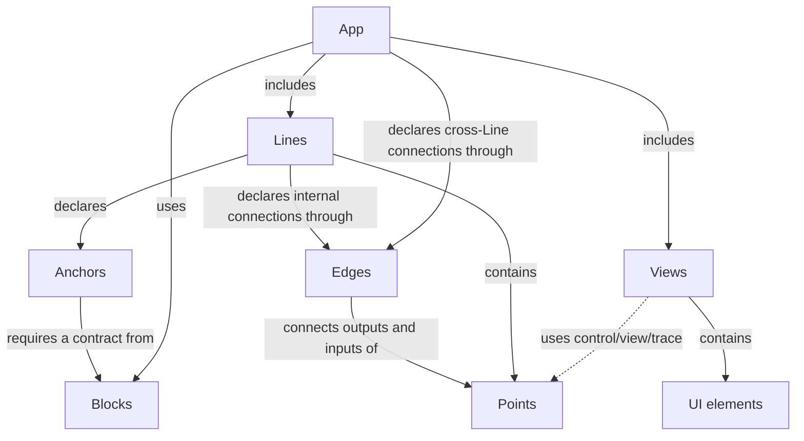
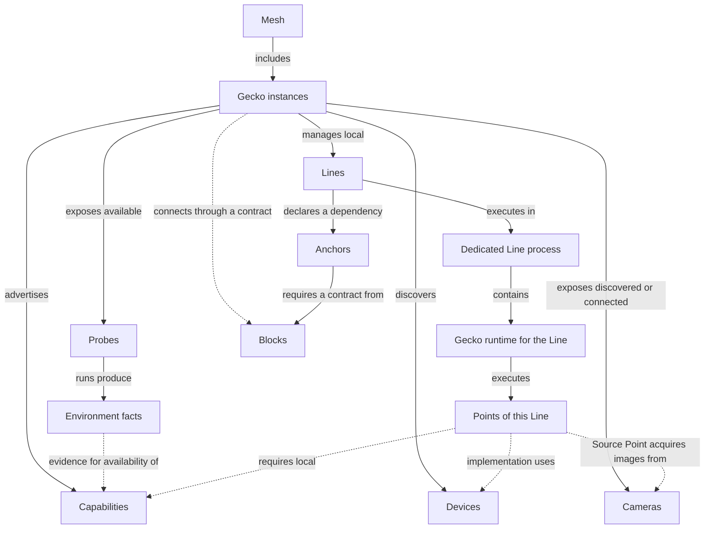

# Gecko — Concept Map

Version 0.11 · October 28, 2026

This document establishes a shared vocabulary for designing the first versions of Gecko. An App defines a shared experience for working on a task, from available capabilities to a verifiable result. The other concepts describe processing, its execution, supported connections, and dependencies on shared services. API formats, configuration formats, and concrete implementation mechanisms will be chosen separately.

The sources are the conversations [“Gecko and Kubernetes Comparison”](https://chatgpt.com/g/g-p-6a1ac79a34548191ac02427895e5a00f/c/6ac20d5b-1eb4-83eb-8543-d13148c2f8e1), [“Pipeline Architecture”](https://chatgpt.com/c/6ac273bd-a1c0-83eb-8759-4d3000c859d8), and subsequent vocabulary refinements in this chat. A Line defines a concrete execution unit; a Point denotes a logical group within a Line; a Block is defined by a domain contract, and an Anchor explicitly describes a Line’s dependency on its provider. A Device denotes the hardware on which selected implementations execute.

**Status:** an agreed working framework for design. It does not describe implemented capabilities. Capability discovery, automatic connection checks, proposed App compositions, and preparation of known services are part of the target UX. Version 1.0.0 targets a complete local workflow on one Gecko; 2.0.0 outlines cooperation across multiple Gecko instances; 3.0.0 outlines a dynamic Mesh and product operation, including a persistent Observer. Migration, load balancing, and seamless failover remain future design directions rather than current guarantees.

The Mesh exchanges facts and capabilities without centralized management and exposes available facts during discovery. Pub/sub is an architectural foundation; the broker's role and minimum requirements are defined at Mesh level. Init and Postinit describe discovery without a mandatory complete-collection boundary; Build prepares a selected revision, and Activation separately permits operational execution. App denotes the composition, not a stage. Placement options, responsibility distribution, and open questions are defined in [Mesh / App](../1-mesh-app/model.md). The Planner is an external App construction system; in the first version, the Gecko that created an App performs App Authority and Coordinator responsibilities for operations requiring coordination. Update and message delivery mechanisms belong to the broker; domain contracts belong to the relevant Gecko layers.

These questions refine implementation while preserving the foundation: Gecko discovers Devices, exposes Cameras, advertises Capabilities, and exposes Probes for discovery and diagnostics; an App defines a shared experience for evaluating a task using Mesh capabilities regardless of interaction mechanism; Lines define execution boundaries; Points organize processing and declare control/view/trace capabilities; Views present an App to users; Edges define supported connections; Blocks are defined by domain contracts; Anchors describe Line dependencies on their providers. Provider preparation is a separate optional capability that does not change a Block’s contract.

**Related documents:**

1. [Mesh / App](../1-mesh-app/model.md)
2. [Gecko / Probe](../2-gecko-probe/model.md)
3. [Line / Point / Edge / View](../4-line-point-edge-view/model.md)
4. [Block / Anchor](../3-block-anchor/model.md)

## 1. Core Idea

The user starts Gecko instances on available machines and platforms. Each Gecko instance discovers accessible Devices, exposes discovered or explicitly connected Cameras, advertises Capabilities, known processing implementations, and connected services, and exposes available Probes for discovery and diagnostics. Gecko instances that can reach one another form a Mesh; supported connection checks provide bandwidth and latency measurements.

For a task, an external Planner builds processing compositions and placements using Mesh facts and Gecko APIs. An App combines a composition description with the interaction available to its user: discover capabilities, assemble or select an option, validate it, start it, observe results, and change processing. The selected option has an explicit configuration of Lines, supported connections, dependencies on Blocks, and Views that can be saved. A Line consists of Points and executes in one dedicated process with the Gecko runtime. A Block is defined by a domain contract understood by Gecko; a service satisfying that contract is connected as a Block. An Anchor defines a particular Line’s dependency on that provider. A View presents selected App data, controls, and diagnostics to the user.

```text
App: inspection

Camera front → Source Point in Line front_camera
Camera back  → Source Point in Line back_camera

Line front_camera ── Anchor detector ──→ Block inference
Line back_camera  ── Anchor detector ──→ Block inference

Inside front_camera (connections use supported Edges):
Source Point → Inference Point → Tracking Point → Output Point
```

An App describes the composition and connections of Lines, their Points, and the Blocks they use for a particular task. A Line defines a concrete execution boundary, and Points describe its internal functional structure. A Block’s contract and a particular provider of that contract are distinct. A container, external service, or Gecko-native implementation can provide the same contract; a Block does not define their deployment mechanism or process ownership.

### 1.1. App as a Shared Interaction Experience

**Lowering the threshold for testing an idea is Gecko’s responsibility.** An App defines a shared experience for working on a task regardless of the interaction mechanism. Its user may be an engineer, an agent, or a programmatic consumer. Available capabilities, their usage conditions, actions, and results must have the same meaning for all users; the particular presentation is chosen separately.

Gecko immediately exposes known Devices, Cameras, environment Capabilities, available Probes, Point, Edge, and Block descriptions, Anchor conditions, and available data representations. An external Planner uses these facts to construct App options; Gecko explains what is ready now, what can be prepared, and what is missing. The presence of a device alone does not promise working processing: compatibility, resources, and dependency readiness are considered.

The user specifies a task, input data, and constraints, receives available options, and evaluates the result. Gecko performs capability discovery and domain checks; the external Planner selects execution options. Technical details remain available for diagnostics and manual control; learning the entire execution structure should not be a prerequisite for the first experiment.

The target cycle is **task and input data → App option → first observable result → change → repeat evaluation → deployment to the operational environment**. Time and the number of required actions from intent to the first verifiable result on real data measure an early part of this experience; feature delivery latency covers the path to verified readiness in the target environment (§1.2). Available models and data limit which hypotheses can be tested; the App makes these limitations explicit.

### 1.2. Development Cycle

**Feature delivery latency** is the elapsed time from a stated need for functionality to that functionality being verified and ready for use in its target environment. It covers discovering capabilities, composing and preparing an App, validating results, iterating on changes, and making the result operational. Time to the first verifiable result is an intermediate measure; the number of required user actions helps explain friction. Frame-processing latency and network latency measure different properties. Concrete measurement boundaries and acceptance criteria are selected for the scenario when implementation evidence is available.

| Implementation version | Scope of the goal |
|---|---|
| **1.0.0** | Reduce feature delivery latency within one Gecko, with a minimal but usable Mesh/App layer. Multiple local Lines and Devices and supported external inputs/services are possible. |
| **2.0.0** | Extend the delivery workflow across multiple cooperating Gecko instances and their devices, with explicitly chosen composition and placement. |
| **3.0.0** | Develop dynamic Mesh participation, App restructuring and product operation, including persistent observation. Detailed mechanisms and guarantees remain open. |

Development follows a **downward requirements pass, then an upward experimental implementation pass**:

1. Start at Mesh / App with the task, version scope, observable behavior and requirements on lower levels. Distinguish current obligations from future directions.
2. Descend through Gecko / Probe, Line / Point / Edge / View, and Block / Anchor and the supporting mechanisms required by the selected scenario. Each step makes its own responsibilities and requirements more specific, down to concrete contracts: inputs, outputs, lifecycle, errors, dependencies and evidence of success. This is a working route through related concerns, not a claim that every document is a strictly nested execution layer.
3. At the lowest required level, define executable experiments and success criteria, then turn upward. Run real experiments and write real code. Use observed behavior to refine and validate that level's contracts before relying on them at the next level.
4. Ascend through the levels, integrating working parts and updating descriptions, guarantees and limitations from experimental evidence. If an experiment contradicts an assumption, revise the affected contract and requirements and record the resulting return to a lower level.
5. On returning to Mesh / App, resolve its implementation details using the validated lower-level behavior, implement and test the complete local workflow, and evaluate the delivery goal. Further passes address remaining limitations or a later version.

The initial Mesh / App pass fixes scope and required behavior. It does not require every format, storage mechanism, timeout or transport setting to be settled before descending. Those questions are kept in a **separate return list**, refined when development comes back to Mesh / App. Lower levels still define the concrete contracts needed for their own experiments. A design decision, an experiment and an implemented capability have distinct statuses; completion is supported by evidence rather than inferred from a document being written.

The [development progress document](../development-cycle.md) records the current position, downward and upward milestones, evidence, and the separate Mesh / App return list. It is the current plan; earlier architecture discussion plans remain historical context.

## 2. Thirteen Core Terms

| Term | Definition | Practical Boundary |
|---|---|---|
| **[Gecko](../2-gecko-probe/model.md)** | A running runtime instance on a particular machine or platform. | Discovers Devices, exposes Cameras, advertises capabilities, manages local Lines, and connects Blocks through contracts; may support preparation of known services. |
| **[Mesh](../1-mesh-app/model.md)** | A decentralized system for exchanging facts and capabilities among Gecko instances. | Exposes partial discovery results and potential execution locations; supports connection checks and App options without a required main Gecko. A new participant does not change a running composition by itself. |
| **[App](../1-mesh-app/model.md)** | A composition for a task and a shared experience for interacting with its capabilities, actions, and results. | An external Planner constructs options; Gecko provides validation, startup, observation, and modification regardless of interaction mechanism. The selected option records Lines, Edges, Anchors, Blocks, Views, implementations, and placement. |
| **[Line](../4-line-point-edge-view/model.md)** | A named processing chain of Points with shared configuration, lifecycle, and diagnostics. | A concrete execution unit: one dedicated process with the Gecko runtime on one Gecko instance. |
| **[Point](../4-line-point-edge-view/model.md)** | An addressable logical processing group within a Line. | Declares processing interfaces and control/view/trace capabilities; this does not imply an independent process or restart. |
| **[View](../4-line-point-edge-view/model.md)** | A user-facing representation of an App combining data and state displays with available user actions. | Consists of UI elements explicitly bound to declared App capabilities; a visual representation is not required to access App capabilities and does not define a separate process. |
| **[Block](../3-block-anchor/model.md)** | A domain service capability defined by a Gecko contract. | A particular service is connected as a Block after contract validation; hardware requirements and startup belong to the provider implementation. Can serve several Lines. |
| **[Anchor](../3-block-anchor/model.md)** | A Line’s dependency on a shared service, specifying the required contract and the conditions under which the Line can operate. | References a particular Block; records required capabilities, readiness conditions, and behavior when unavailable. |
| **[Edge](../4-line-point-edge-view/model.md)** | A supported way to connect one Point’s output to another Point’s input, with defined rules and constraints. | Applied to particular Point interfaces during assembly; the Points may belong to the same Line or different Lines. An exposed Line interface refers to a Point interface. |
| **[Capability](../2-gecko-probe/model.md#2-capabilities-and-execution-requirements)** | An execution possibility in a particular Gecko's environment, considering hardware, software, and access conditions. | Matched against local requirements of selected implementations; supporting facts have conditions and freshness. It does not guarantee free resources or App readiness; Block availability is checked through Anchors. |
| **[Probe](../2-gecko-probe/model.md#3-preliminary-probe-model)** | A separately addressable diagnostic task for discovery, validation, search, testing, and obtaining useful artifacts or cache. | A Probe run is one execution through Operation. Results provide facts and may support or refute Capability availability; an available Probe does not establish that availability. |
| **[Device](#4-devices)** | An addressable hardware execution unit accessible to a particular Gecko instance. | A CPU, GPU, or other accelerator with characteristics, internal structure, resources, and state; it is distinct from a Block, Capability, or Probe. |
| **[Camera](#5-cameras)** | An addressable source of images from a particular camera, discovered or explicitly connected to Gecko. | Exposes known streams or image acquisition modes and access conditions. A Source Point acquires its data for a Line; a Camera retains its identity independently of the Line and is distinct from a compute Device, Point, Capability, or Probe. |

“The Gecko project” refers to the whole system, while “a Gecko instance” refers to a particular runtime. A machine provides the environment for Gecko. This document does not constrain the number of instances on one machine.

The geometric names reflect structure: a Point is a functional point within a Line; a Line is a processing chain; a Block is a service capability defined by a contract; an Edge is a supported way to connect; an Anchor is a Line’s support from a service; a View is a projection of an App for the user. Hardware keeps the familiar name Device without a geometric renaming. The vocabulary uses Point. Dot is not introduced as a separate entity.

Capability and Probe use functional names: the former describes an environment possibility, the latter obtains facts through a diagnostic task. Lowercase “capability” in other contracts retains its ordinary meaning and does not automatically denote the environment Capability entity.

## 3. Structure and Execution Boundaries

### 3.1. App Composition

This diagram describes application composition and relationships between concepts. A Line contains Points. Every processing connection through an Edge joins a Point output to a Point input, whether the Points belong to the same Line or different Lines. A Line declares internal connections; the App declares connections across Line boundaries. Anchors describe dependencies on Blocks. Cameras and Devices belong to the execution environment shown in section 3.2.



UI elements belong to the App’s Views. Slider, Button, and VideoView are not processing Points within a Line. They bind to declared capabilities of Lines, their Points, and Blocks. The dedicated-process rule for a Line does not apply to a View or each UI element.

### 3.2. Environment and Execution Boundaries

This diagram describes placement and execution. An App can span several Gecko instances; a particular Line executes entirely on one of them. Gecko exposes discovered or connected Cameras; a Source Point within a Line acquires their images. A Camera may be local or networked. Connecting a Block through a contract does not imply placing its process on that Gecko instance.



A Line has an explicit boundary: one Gecko instance and one dedicated process with the Gecko runtime during execution. Placement applies to the whole Line. Its Points cannot independently move to other machines without changing the execution structure.

**One source → one Line is the default policy.** A source can be a camera, file, or another supported source. Multiple inputs within one Line are possible when that scenario is explicitly supported; this is not a commitment for the first version.

A Block has its own service boundary defined by its implementation. Sharing a Block does not merge Lines or change their restart boundaries. Gecko may manage service startup where supported, but does not impose a “one dedicated process” rule on every Block.

### 3.3. Vocabulary Changes

#### From Version 0.10 to 0.11

The former Axis term is split into Capability for an environment execution possibility and Probe for a diagnostic task. Probe runs produce facts that may support Capability availability. Definitions, examples, and the environment diagram now distinguish these roles; Capability does not imply free resources or App readiness.

#### From Version 0.3 to 0.4

| Previously | Now |
|---|---|
| App composition and the execution environment are mixed in one diagram | App composition is shown separately from placement and execution |

## 4. Devices

A Device is a CPU, discrete or integrated GPU, NPU, or other hardware accelerator that Gecko identifies and selects individually for execution. ARM/x86 are CPU architecture characteristics, while Jetson or an embedded board is a platform containing accessible Devices. For the first version, a CPU can be represented as one Device per machine, describing cores and logical CPUs within it; socket and NUMA detail can be added when needed.

```text
Gecko jetson-01
├── platform: Jetson
├── Device cpu-0: arm64 architecture, cores, and logical CPUs
├── Device gpu-0: characteristics, memory, state
├── Camera entrance: connection, streams and modes, access state
├── Capabilities: available execution possibilities under stated conditions
└── Probes: available discovery, access, and load checks
```

Each CPU core is not a separate Device. Cores, threads, memory, and other internal resources are considered during placement and execution. Affinity, quota, and exclusive reservation are different conditions; binding to logical CPUs does not itself mean exclusive allocation. Concrete resource allocation mechanisms will be chosen separately.

One Line may use several Devices, such as a CPU for data preparation and a GPU for inference, while remaining one process on one Gecko instance. Physical presence of a Device does not guarantee an available Capability: compatible software and actual access are required. Several Gecko instances on one machine may share hardware; node advertisements do not imply independent resource inventories.

### 4.1. Vocabulary Changes

#### From Version 0.4 to 0.5

| Previously | Now |
|---|---|
| Hardware is mentioned without an addressable entity | Device describes CPUs, GPUs, and accelerators; cores and threads remain internal resources |

### 4.2. Open Questions

- Device, topology, requirement, and binding formats; shared resource accounting and reservation rules.

## 5. Cameras

A Camera denotes a particular image source, such as a locally connected or network camera. Gecko exposes its stable name, known streams and modes (format, resolution, frame rate), access state, and supported actions. Discovery and control depend on the connection implementation; information that cannot be obtained is marked unknown.

A Source Point selects a Camera and a supported stream or mode, acquires images, and exposes them through its processing interface. The Camera binding is saved in the App configuration. Subsequent connections through Edges join Point interfaces. Restarting a Line does not change the Camera’s identity and does not by itself restart the camera.

```text
Camera entrance → Source Point in Line entrance → Edge → Inference Point
```

A Camera describes a particular source; a Capability describes Gecko’s ability to work with a supported source type; a Probe can check discovery or access to a Camera; a Device is hardware for executing processing. A recorded file can be a Source Point input for an experiment, but does not itself become a Camera. The “one source → one Line” policy does not imply exclusive ownership of a Camera: use by multiple Lines requires connection support or shared acquisition, along with validation of access and load constraints.

### 5.1. Vocabulary Changes

#### From Version 0.6 to 0.7

A Camera denotes a particular image source with stable identity, streams or modes, and access conditions. A Source Point acquires its data for a Line. A Camera is distinct from a compute Device, an environment Capability (then called Axis), and a recorded file; discovered or connected Cameras are available during App selection.

### 5.2. Open Questions

- Camera identity, supported connections, stream and mode descriptions, control, and shared access rules.
